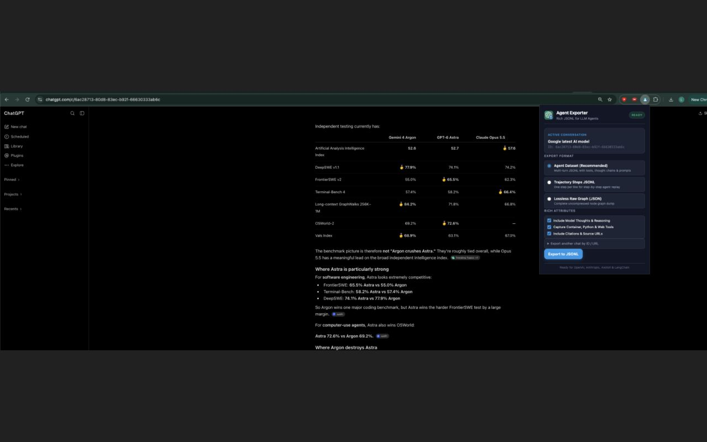

<p align="center">
  
</p>

<h1 align="center">ChatGPT to Agent JSONL Exporter</h1>

<p align="center">
  <strong>Export rich ChatGPT conversations as agent-ready JSONL datasets with multi-turn prompts, reasoning thoughts, real tool calls, and outputs.</strong>
</p>

<p align="center">
  
  
  
  
</p>

<p align="center">
  
</p>

---

## 🌟 Overview

When building or fine-tuning AI agents (using OpenAI, Anthropic, LangChain, DSPy, Axolotl, or Unsloth), you need realistic multi-turn conversation trajectories that preserve:
- **Exact user prompts and attachments**
- **Model reasoning & Chain-of-Thought (o1, o3, thinking models)**
- **Real tool invocations** (Bash/container commands, Python code interpreter, search queries)
- **Tool execution results & stdout**

Standard browser copy-paste loses tool calls and internal reasoning. **ChatGPT to Agent JSONL Exporter** runs natively in your browser to extract the full conversation graph and produces clean, standard JSONL datasets ready for training or evaluation.

---

## ✨ Features

- **1-Click Export:** Automatically detects the active chat on `chatgpt.com`.
- **Preserves Reasoning Thoughts:** Extracts internal chain-of-thought blocks (`gpt-5-thinking`, `o1`, `o3`).
- **Captures Real Tool Calls:** Identifies real tool executions (`container.exec`, `python`, `api_tool.call_tool`, `web.run`, `dalle`) and filters out internal broadcast tags.
- **Multiple Export Formats:**
  - **Agent Dataset JSONL:** Standard multi-turn format (`{"messages": [{"role": "user", ...}, {"role": "assistant", "tool_calls": [...]}]}`).
  - **Trajectory Steps JSONL:** 1 line per step (`{"step": 1, ...}`) for RL & step-by-step agent replay.
  - **Lossless Raw JSON:** Complete uncompressed mapping graph dump.
- **100% Local & Private:** Runs entirely on client-side JavaScript. Zero external servers, zero telemetry, zero credential tracking.
- **Least Permissions:** Uses only `activeTab` and `scripting`. Zero host permissions required.

---

## 🚀 Quick Start (Chrome Extension)

### Run Locally (Developer Mode)
1. Clone this repository:
   ```bash
   git clone https://github.com/Carbrex/chatgpt-agent-exporter.git
   ```
2. Open Google Chrome and go to `chrome://extensions/`.
3. Enable **Developer mode** (top-right toggle).
4. Click **Load unpacked** (top-left) and select this repository folder.
5. Open any conversation on [chatgpt.com](https://chatgpt.com) and click the extension icon in your toolbar to export!

---

## 🐍 Python CLI Tool

If you have exported your data via ChatGPT settings (`conversations.json`) or saved a raw network JSON:

```bash
# Convert a raw ChatGPT conversation or export into rich agent JSONL
python3 cli/export_chatgpt_jsonl.py <input.json | input_steps.jsonl> [output.jsonl]
```

---

## 📋 JSONL Output Schema

The exported `*_agent.jsonl` format complies with industry-standard OpenAI / Anthropic agent fine-tuning specifications:

```json
{
  "id": "6aa6faea-cc0c-83ee-b244-ea2736250056",
  "title": "ICLR Paper Revision Plan",
  "total_messages": 209,
  "messages": [
    {
      "role": "user",
      "content": "Review the proof of Lemma 3.1 and run the federated GMM experiment."
    },
    {
      "role": "assistant",
      "thought": "User wants verification of Lemma 3.1. I will run the test in container.",
      "content": null,
      "tool_calls": [
        {
          "id": "call_12345",
          "type": "function",
          "function": {
            "name": "container.exec",
            "arguments": "{\"code\": \"python3 -c \\\"import torch; print('Tested')\\\"\"}"
          }
        }
      ]
    },
    {
      "role": "tool",
      "tool_call_id": "call_12345",
      "name": "container.exec",
      "content": "Tested"
    },
    {
      "role": "assistant",
      "content": "The federated moment norm verified successfully..."
    }
  ]
}
```

---

## 🔒 Privacy & Security

This extension runs **100% locally in your browser session**:
- No external server or proxy.
- No analytics or tracking scripts.
- No cookies or credentials leave your computer.
- Read our full [Privacy Policy](https://gist.github.com/Carbrex/26d1b515b6d8c2f21a1d394678e606b7).

---

## 📄 License

Released under the [MIT License](LICENSE).
